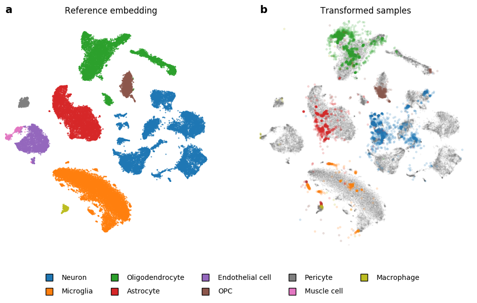

# Embedding to Reference t-SNE Space Addresses Batch Effects in Single-Cell Classification



## Data

All data used in the notebooks and figures are available at http://file.biolab.si/tsne-embedding/ and can easily be downloaded by running the `data/download.sh` script.

## Updates

Since the original publication, the API for openTSNE has changed and the original notebooks will no longer run. The `notebooks/pancreas.ipynb` has been updated to account for recent changes in openTSNE, but the original notebooks in `figures/` have been left in their original state at the time of publication. If you want to reproduce the results exactly, older versions of openTSNE should be used.

## Citation
```bibtex
@article {Policar2021,
  author = {Poli{\v{c}}ar, Pavlin G. and Stra{\v{z}}ar, Martin and Zupan, Bla{\v{z}}},
  title = {Embedding to Reference t-SNE Space Addresses Batch Effects in Single-Cell Classification},
  journal = {Machine Learning},
  pages = {1--20},
  year = {2021},
  publisher = {Springer},
  doi = {10.1007/s10994-021-06043-1}
}
```
